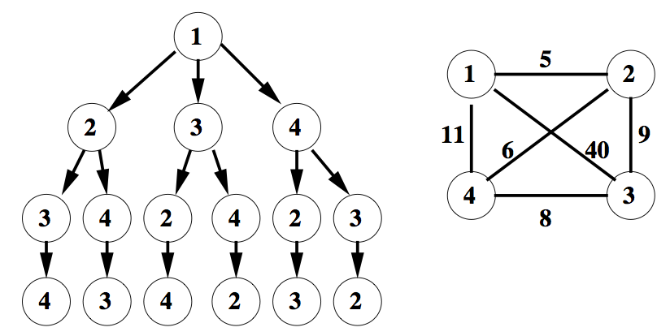

# PCM-TSP

## Objectif
L’objectif de ce projet est double : c’est à la fois un exercice et une évaluation. Vous allez développer un programme qui tire parti d’une architecture multicœur, en utilisant les techniques vues en cours. Votre évaluation portera sur la qualité du programme développé et sur celle de votre rapport.

Le travail consiste à résoudre le problème du voyageur de commerce (TSP, Traveling Salesman Problem) avec une méthode de séparation et évaluation (branch-and-bound). Le voyageur de commerce doit visiter une liste de N villes et revenir au point de départ. Il faut visiter une seule fois chacune des N villes, puis revenir à la ville de départ, en suivant le circuit le plus court. Comme le circuit est fermé, le choix de la ville de départ n’a pas d’importance. C’est un problème difficile d’optimisation combinatoire : au départ d’une ville donnée, il y a (N-1)! circuits qui passent par les N-1 autres villes et reviennent à la ville de départ (nous supposons qu’il existe une route directe entre toute paire de villes).

L’entrée du problème est une liste de villes, chacune avec ses coordonnées X et Y. La sortie du programme est la liste ordonnée des villes du circuit le plus court, avec sa longueur. Deux solutions distinctes de même longueur sont équivalentes (par exemple, un circuit et le même circuit parcouru en sens inverse).

## Déroulement et évaluation
Le travail se fait en groupes de deux personnes. Le projet se déroule en plusieurs étapes.

- 9 novembre : début du projet. Vous lisez l’énoncé, vous comprenez le problème et vous vous familiarisez avec la version séquentielle fournie : vous l’exécutez, vous la modifiez, vous mesurez son temps d’exécution.
- 30 novembre et 7 décembre : travail en classe. Ces deux séances sont consacrées au projet. L’objectif pour le 30 novembre est d’avoir une implémentation parallèle qui tourne. La performance n’est pas encore une préoccupation à ce stade.
- 14 décembre : présentation de vos résultats. Chaque groupe présente son travail (présentation informelle de 10 à 20 minutes). La présentation est obligatoire et compte dans la note. Vous recevez un retour immédiat, donné pendant la présentation.
- Entre la présentation et le rendu : amélioration du projet. Vous corrigez et améliorez votre solution en tenant compte du retour reçu.
- 18 janvier 2027 : date limite pour rendre le programme et le rapport

La présentation ne sert pas seulement à vous évaluer. Elle vous permet de repérer, avant le rendu, ce qui ne va pas dans votre solution. Si vous décidez de changer quelque chose à la suite du retour reçu (une structure de données, la taille des tâches, la méthode de mesure, etc.), le rapport doit le décrire : ce que vous aviez avant, ce que vous avez modifié, pourquoi, et ce que les mesures montrent après le changement. Une erreur identifiée à la présentation, puis comprise et corrigée dans le rapport, compte beaucoup en votre faveur.

## Branch-and-bound
Il existe de nombreuses méthodes pour résoudre le TSP. Nous allons utiliser un algorithme de branch-and-bound (séparation et évaluation). Pour le comprendre, considérons d’abord la recherche exhaustive : elle construit tous les circuits possibles à partir d’une ville donnée. La figure ci-dessous montre une carte de 4 villes et l’arbre des chemins possibles à partir de la ville 1.



Pour ce problème, D1→2=5, D1→3=40, D1→4=11, D2→3=9, D2→4=6 et D3→4=8 (les distances sont symétriques : DK→L=DL→K). Chaque chemin de la racine à une feuille de l’arbre visite les trois autres villes. Pour obtenir un circuit, il faut ajouter le retour à la ville 1. Par exemple, si l’on prend la branche du milieu à la première ville, puis la branche de droite à la deuxième, on obtient le chemin 1→3→4→2, de longueur 54 (40+8+6). Le circuit correspondant est 1→3→4→2→1, de longueur 59 (54 plus 5 pour le retour de 2 à 1). À partir de la ville 1, il y a six (3!) circuits possibles.

La recherche exhaustive de cet exemple calcule la longueur des six circuits et retient le plus court. Ici, la longueur minimale est 33. Elle est atteinte par 1→2→3→4→1 et par 1→4→3→2→1, qui est le même circuit parcouru en sens inverse.

Le parcours de l’arbre est naturellement récursif. La distance déjà accumulée de la racine jusqu’à une ville peut être réutilisée pour calculer la longueur de tous les chemins qui prolongent celui-ci (inutile de la recalculer). L’approche branch-and-bound exploite cette formulation pour élaguer les branches inutiles de l’arbre, et diminuer ainsi le nombre de chemins à évaluer.

On évalue d’abord un circuit complet, par exemple 1→2→3→4→1, de longueur 33 (5+9+8+11). Cette longueur devient la borne (bound) du problème, c’est-à-dire la longueur du plus court circuit connu. Tant qu’aucun circuit n’a été évalué, il n’y a pas de borne : on la considère infinie. Supposons ensuite qu’un autre chemin soit partiellement évalué, par exemple 1→3, dont la longueur partielle est déjà 40, donc supérieure ou égale à la borne actuelle. Les distances étant positives ou nulles, tout circuit qui prolonge ce chemin aura une longueur au moins égale à 40. Il ne pourra donc pas être plus court que la borne. Il est inutile de poursuivre : on élague (prune) la branche, sans calculer ses sous-branches.

Chaque fois qu’un nouveau circuit complet est évalué et que sa longueur est strictement inférieure à la borne, ce circuit devient la nouvelle borne. Un circuit de même longueur que la borne n’améliore pas la solution, puisque deux solutions de même longueur sont équivalentes. C’est pourquoi on élague dès que la longueur partielle est supérieure ou égale à la borne.

Dans l’exemple, en explorant les villes dans l’ordre croissant, la borne vaut 33 après le premier circuit. La branche 1→3 est élaguée, ce qui évite deux des six circuits. Les quatre autres sont évalués, mais aucun n’est strictement plus court que 33 : la solution reste donc 1→2→3→4→1. Avec 4 villes, l’économie est modeste. Sur de grands arbres, elle peut être considérable : l’algorithme évite d’évaluer complètement un très grand nombre de combinaisons.

La méthode branch-and-bound mémorise donc toujours le meilleur circuit trouvé, et l’utilise comme borne pour ne pas parcourir les branches de l’arbre qui ne peuvent pas donner de meilleure solution.

## Le code fourni
Le code de départ contient des programmes séquentiels, écrits en C++, qui fonctionnent déjà :

- task.hpp : le modèle de tâche (Task), les collections de tâches (TaskCollection, TaskStack, FixedTaskStack) et les exécuteurs de tâches (TaskRunner, DirectTaskRunner, PartitionedTaskStackRunner).
- tspgraph.hpp et tsptask.hpp : la lecture du graphe, la classe TSPPath et la tâche TSPTask, qui résout le TSP par branch-and-bound.
- tsp.cpp : le programme qui résout un TSP avec TSPTask et les deux exécuteurs fournis. Il compare leurs résultats.
- tspprint.cpp : un exemple qui lit et affiche un graphe.
- intvecsorttask.hpp et intvecsort.cpp : un tri de vecteur d’entiers, écrit comme une tâche. Cet exemple est là pour expliquer comment utiliser Task (voir ci-dessous).
- Makefile, dj38.tsp.

Le DirectTaskRunner appelle directement solve(). Le PartitionedTaskStackRunner appelle split(), qui sous-divise une tâche en sous-tâches, traite récursivement toutes les sous-tâches, puis appelle merge(). Tous les deux sont séquentiels.

Le programme lit cette liste et calcule une matrice de distances, dans laquelle l’élément DK→L est la distance de la ville K à la ville L. Par simplicité, nous supposons que les routes sont des lignes droites d’une ville à l’autre : les distances sont euclidiennes, arrondies à l’entier le plus proche (type EUC_2D du format TSPLIB, utilisé par les fichiers d'exemple de l’Université de Waterloo). Dans ces fichiers, les villes sont numérotées à partir de 1 ; dans le programme fourni, elles le sont à partir de 0.

## Travail à exécuter
Vous devez proposer une implémentation en C++ qui s’exécute en parallèle, avec des threads POSIX (Pthreads) ou des threads de la STL de C++ (std::thread). La distribution du travail aux threads passe par une structure de données non bloquante (lock-free). Pour cela, vous écrivez un nouvel exécuteur de tâches (un TaskRunner) et une nouvelle collection de tâches (une TaskCollection). Vous devez démontrer votre implémentation en comparant son temps d’exécution parallèle avec le temps séquentiel.

Contrainte : le modèle de tâche

Vous devez utiliser le modèle de tâche fourni. Une tâche a les méthodes suivantes :

- split(sous-tâches) remplit une collection avec les sous-tâches de la tâche appelée, et retourne leur nombre. Elle retourne 0 si la tâche ne se découpe pas : l’exécuteur appelle alors solve().
- merge(sous-tâches) calcule le résultat de la tâche appelée à partir des résultats des sous-tâches. Elle ne doit être appelée qu’une seule fois, et seulement quand toutes ses sous-tâches sont terminées.
- solve() calcule le résultat de la tâche appelée sans la découper en sous-tâches.

Les deux exemples donnés n’implémentent pas merge() de la même façon. Dans le tri, merge() construit le résultat de la tâche à partir de ceux de ses sous-tâches. Dans TSPTask, le résultat est le meilleur circuit trouvé, conservé dans une variable partagée par toutes les tâches, et merge() ne fait que libérer les sous-tâches.

Le code fourni n’est pas conçu pour plusieurs threads. Notamment, la variable qui contient le meilleur circuit de TSPTask, l’allocateur de tâches TSPAllocator et la liste de réutilisation de IntVecSortTask ne sont pas protégés contre les accès concurrents. Les rendre corrects fait partie de votre travail.

Choix de la taille du problème. Choisissez une instance du TSP dont la résolution séquentielle prend entre 10 et 15 minutes sur les machines Xeon Phi que vous utiliserez pour vos mesures, avec DirectTaskRunner et un programme compilé avec les optimisations. Prenez des exemples sur le site web de l’Université de Waterloo. Seul le type EUC_2D est supporté. Vous pouvez supprimer des villes d’un exemple pour ajuster la taille du problème (le programme fourni garde alors les N premières villes).

Pistes d’optimisation. À partir d’une certaine profondeur, découper une tâche coûte plus cher que la résoudre séquentiellement. Choisissez la profondeur de coupure (voir TSPTask::cutoff()) en la mesurant, et discutez-la dans votre rapport. Comparez l’utilisation d’une borne par thread avec une borne pour tout le programme. La gestion du graphe et des chemins (tspgraph.hpp et la classe TSPPath) a peu d’intérêt à être optimisée. Ne la modifiez qu’en cas de besoin d’implémentation.

## Contraintes d'implémentation
Les livrables du projet servent à vous noter. Les contraintes ci-dessous sont importantes : toute déviation, même si elle améliore les performances, sera considérée comme négative et diminuera la note.

- Le problème du TSP doit être résolu par la même méthode que dans le programme fourni (branch-and-bound).
- Vous devez implémenter une solution parallèle avec des threads C++ qui utilise une structure non bloquante (lock-free) comme structure de données partagée.
    - Non bloquante signifie lock-free : si un thread est suspendu ou ralenti au milieu d’une opération, les autres threads continuent de progresser, et l’ensemble des threads fait toujours progresser le système. Les opérations de la structure ne peuvent donc utiliser ni verrou (mutex, spinlock, sémaphore, variable de condition) ni attente d’une action d’un autre thread.
    - La structure partagée sert à stocker les tâches à exécuter, qui sont traitées par un pool de threads de taille fixe.
        - Chaque thread du pool récupère ses tâches dans la structure partagée, et nulle part ailleurs.
        - Un thread peut créer de nouvelles tâches et les ajouter à la structure.
    - Vous choisissez la sémantique de cette structure et l’interface qu’elle implémente (file simple, pile, file multiple, etc.).
    - La structure partagée doit aider à détecter la terminaison de la résolution du problème : tous les threads doivent s’arrêter quand il n’y a plus de travail, aucune tâche ne doit être perdue ni exécutée à tort, et le programme ne doit jamais rester bloqué à la fin.
    - La structure partagée doit être implémentée par vos soins, avec des instructions atomiques.
    - Vous devez dire dans le rapport si le problème ABA concerne votre structure, et comment vous le traitez (ou pourquoi il ne se pose pas). De la même façon, justifiez les ordres mémoire que vous avez choisis pour vos opérations atomiques.
- Le programme doit se compiler avec GCC.
- Le programme doit fonctionner sous Linux, avec un nombre de threads donné en paramètre.
- Le programme doit pouvoir utiliser tous les cœurs disponibles de la machine Xeon Phi (256 threads).
Évaluation de l'implémentation
Vous devez préparer des expériences qui produisent des mesures de temps. Vous exécuterez votre programme plusieurs fois, avec un nombre de threads différent à chaque fois, et vous mesurerez le temps de chaque exécution.

### Protocole de mesure

- Machine. Toutes les mesures se font sur les machines Xeon Phi mises à votre disposition, pas sur votre ordinateur personnel.
- Une seule instance. Toutes les mesures portent sur la même instance du problème, celle choisie dans la partie « Travail à exécuter ». Le temps de référence est le temps de DirectTaskRunner (séquentiel) sur cette instance, avec les mêmes options de compilation que le programme parallèle. Ce n’est pas le temps de votre programme parallèle avec 1 thread.
- Nombre de threads. Utilisez des nombres de threads en progression arithmétique (pas constant), par exemple tous les 8 ou tous les 16 threads, jusqu’à au moins 256 threads. Pas de puissances de 2. Mesurez aussi 1 thread, pour connaître le surcoût de votre version parallèle.
- Plusieurs mesures par point. Répétez chaque mesure plusieurs fois (au moins 3) et indiquez, pour chaque point, la valeur retenue (médiane ou moyenne, à préciser) et la dispersion des mesures. Les temps d’une exécution parallèle peuvent varier d’une fois à l’autre, même avec le même nombre de threads : expliquez pourquoi.
- Ce qui est mesuré. Le temps de résolution, depuis la création des threads jusqu’à la fin de la résolution, après la lecture du fichier et le calcul de la matrice de distances. Utilisez une horloge monotone (std::chrono::steady_clock).
- Vérification. À chaque exécution, le programme doit vérifier que la longueur du circuit trouvé est égale à celle du résultat séquentiel. Plusieurs circuits de même longueur sont équivalents.
### Graphes demandés

Vous devez créer au moins deux graphes avec les mesures effectuées, tous deux en fonction du nombre de threads :

- la courbe de speed-up, c’est-à-dire le temps séquentiel divisé par le temps parallèle ;
- la courbe d’efficience, c’est-à-dire le speed-up divisé par le nombre de threads.

Les deux axes sont linéaires. Dessinez sur le graphe de speed-up la droite du speed-up idéal (speed-up égal au nombre de threads), pour pouvoir comparer. Les graphes doivent être générés avec Gnuplot ou un autre logiciel libre, et présentés en PDF. Ils seront expliqués dans le rapport. Le graphe ci-dessous n’est qu’une illustration de la forme générale, pas le résultat à reproduire.

Vous devez préparer des expériences qui génèrent de mesures de temps. Vous exécuterez votre programme plusieurs fois, chaque fois avec un nombre de threads diférent. Vous mesurerez le temps de chaque exécution. Idéalement, vous prendrez plusieurs mesures de temps pour chaque point. Avec ces mesures vous devez créer au moins deux graphes :


## Objets à rendre
Le travail rendu doit contenir :

- Les sources de tous les programmes développés, sans fichiers compilés (ni exécutables, ni fichiers objets). À la racine, un script nommé do-it qui compile le tout avec GCC et exécute tous les tests.
- Un rapport au format PDF (voir ci-dessous).
- Un formulaire d’auto-évaluation (il sera fourni plus tard).

Le rendu a lieu à la date indiquée dans « Déroulement et évaluation ».

## Contenu et format du rapport
Le rapport contient 5 ou 6 pages A4, au format PDF, en police de taille 12. Les fichiers Word ne sont pas acceptés.

Il contient les parties suivantes.

- Une introduction qui présente les idées de base de la solution et résume les résultats, sans donner de chiffres précis.
- Une présentation des implémentations développées.
    - Expliquez pourquoi le code est tel qu’il est : quelles sont les raisons de vos choix, et quelles alternatives vous avez écartées.
    - Votre analyse doit indiquer au moins la décomposition du problème en tâches, la structure du programme et l’identification du parallélisme.
    - Décrivez votre structure partagée : qui y ajoute des tâches, qui en retire, comment la terminaison est détectée, et comment vous garantissez que merge() n’est appelée qu’une seule fois, après la fin de toutes les sous-tâches.
    - Dites si le problème ABA concerne votre structure et comment vous le traitez, et justifiez vos ordres mémoire (voir « Contraintes d’implémentation »).
- Une présentation des expériences et des mesures de performance collectées.
    - Décrivez votre protocole (voir « Évaluation de l’implémentation »).
    - Discutez la taille idéale du problème (nombre de villes) pour l’environnement utilisé.
    - Discutez la taille des tâches (la profondeur à partir de laquelle on résout séquentiellement), avec vos propres mesures.
    - Présentez les résultats avec les graphes demandés (speed-up et efficacité), et expliquez leur forme, en particulier là où ils s’éloignent de l’idéal.
- Les modifications faites après la présentation. Si vous avez changé quelque chose à la suite du retour reçu le jour de la présentation, décrivez ce qu’il y avait avant, ce que vous avez modifié, pourquoi, et ce que les mesures montrent après le changement.
- Une conclusion qui rappelle les avantages des choix faits et propose quelques améliorations.

## Formation des groupes
Vous devez former des groupes de 2 personnes. Envoyer un email à marcelo.pasin@he-arc.ch les groupes formés, avec :

- Le nom des composants du groupe
- Une clé publique SSH du type ssh-ed25519 par étudiant, pour l'accès aux machines Xeon Phi

## Infrastructure de calcul
Vos devez impérativement utiliser les Xeon Phi (phi-1 et phi-2) mis à disposition par l'enseignant.

Vous recevrez un email avec votre nom-du-compte dans les machines Xeon Phi et un fichier cle-proxy contenant une clé privée pour le proxy. Copier le fichier cle-proxy dans vos répertoires ~/.ssh et rajouter les lignes suivantes dans vos fichiers ~/.ssh/config:

```
Host iiun-cluster
   Hostname      clusterinfo.unineuchatel.ch
   User          pasin-pcm-2025
   IdentitiesOnly yes
   IdentityFile  /VOTRE-HOME-DIR/.ssh/cle-proxy

Host *.maas
   User          nom-du-compte
   StrictHostKeyChecking no
   ForwardAgent  yes
   ProxyJump     iiun-cluster
   IdentityFile  /VOTRE-HOME-DIR/.ssh/VOTRE-CLE-PRIVEE-SSH
```

Une fois votre fichier de configuration préparé, connecter aux machines (phi-1 et phi-2) avec la commande:

```bash
bash% ssh phi-1.maas
```

Un [CALENDRIER DE RÉSERVATION](https://docs.google.com/spreadsheets/d/1qwOKXMd4OwLue7iKwUVILkxLKSMsos1sH5iW_b5hE7Q/edit?pli=1&gid=0#gid=0) est à la disposition des étudiants, pour réserver les machines. Losque vous mesurerez les temps d'exécution, vous devrez être seul(e)s sur les machines, pour être sur(e)s que vous utilisez les cœurs ce façon adéquate.

> Ce projet a été vaguement inspiré par un projet similaire, donné par le professeur Kayvon Fatahalian, de l'Université Carnegie Mellon.